<!-- Troque SEU_USUARIO pelo seu usuário do GitHub em todo este arquivo -->

<!--h1 align="center">Oi, eu sou o SEU NOME 👋</h1>
<p align="center">
  Dev que transforma café em código e bug em "feature não documentada".
</p-->

<p align="center">
  <a href="https://thegitcity.com/alisonmdeliberali">
    
  </a>
</p>

<p align="center">
  <a href="https://thegitcity.com/alisonmdeliberali">
    
  </a>
</p>

### 🧠 Sobre mim

```python
class Eu:
    trabalhando_em = "algo legal que logo vira repositório"
    aprendendo     = ["coisa nova", "outra coisa nova"]
    pergunte_sobre = ["seu assunto favorito"]
    fato_aleatorio = "já resolvi um bug só explicando ele pro patinho de borracha 🦆"
```

### 🔥 Constância

<p align="center">
  
</p>

### 📈 Gráfico de atividade

<p align="center">
  
</p>

<p align="center"><sub>Painel atualizado todo dia por um robô dedicado e levemente sarcástico 🤖</sub></p>
